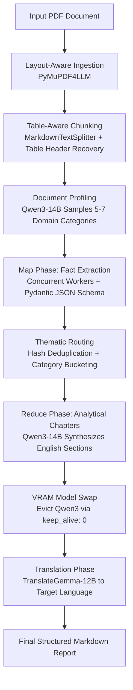

# Document Intelligence Pipeline

A local, multi-stage document processing pipeline designed to ingest long-form PDFs (e.g., 800-page SEC 10-K filings, corporate regulations), extract verified facts using schema-constrained local LLMs, and produce analytical reports translated into target languages (Azerbaijani / Russian).

Built to run entirely offline on consumer GPUs (12 GB VRAM) by implementing dynamic model swapping and VRAM-aware worker scaling.

---

## Architecture Overview



---

## Key Technical Decisions

1. **Table-Aware Chunking**: Standard text splitters break markdown tables across arbitrary boundaries, stripping headers from subsequent rows and causing models to hallucinate numeric context. The chunker inspects table separator lines (`|---|`) and prepends table headers to severed chunks automatically.
2. **Two-Phase Memory Management**: Running `qwen3:14b` (~8.5 GB in 4-bit) and `translategemma:12b` (~7.5 GB) concurrently exceeds standard 12 GB GPU limits. The pipeline probes `nvidia-smi` at startup, scales thread pools dynamically, and explicitly evicts inactive models via Ollama's `keep_alive: 0` before the translation phase.
3. **Structured Extraction with Truncation Recovery**: Extracts are enforced via strict Pydantic JSON schemas. When an extract hits generation token limits (`done_reason == "length"`), an internal balancing parser (`_try_repair_json`) reconstructs broken object and array boundaries instead of discarding the batch.
4. **Degeneration Guard**: Local models occasionally enter repetitive loops during analytical summarization. An inline n-gram fingerprint detector identifies sentence-level loops and truncates the stream at the clean boundary.

---

## Tech Stack

- **Inference Runtime**: [Ollama](https://ollama.com/) (`qwen3:14b`, `translategemma:12b`)
- **Backend API**: FastAPI, Uvicorn, Pydantic v2
- **Document Processing**: PyMuPDF4LLM, LangChain Text Splitters, HuggingFace Transformers
- **Deployment**: Docker Compose, NVIDIA Container Toolkit

---

## Quickstart

### Prerequisites

- NVIDIA GPU with 12+ GB VRAM and Container Toolkit installed (or local Ollama instance)
- Docker & Docker Compose

### 1. Model Preparation

Pull the required models in Ollama:

```bash
ollama pull qwen3:14b
ollama pull translategemma:12b
```

### 2. Running via Docker Compose

```bash
docker compose up --build
```

The container starts:
- Ollama service on port `11434`
- FastAPI server on port `8000` (or background runner)
- SSH management interface on port `2222`

### 3. Running Locally (Direct Python)

```bash
# Create virtual environment
python -m venv venv
source venv/bin/activate  # On Windows: .\venv\Scripts\activate

# Install dependencies
pip install -r requirements.txt

# Run API server
uvicorn main:app --host 0.0.0.0 --port 8000
```

---

## API Reference

### `POST /upload`
Uploads a PDF document and starts an asynchronous processing job.

- **Request**: `multipart/form-data` with `file: UploadFile`
- **Response**:
```json
{
  "job_id": "c9bf9e57-1685-4c89-bafb-ff5af830be8a",
  "message": "Document processing started"
}
```

### `GET /status/{job_id}`
Checks the current processing status.

- **Response (Processing)**:
```json
{
  "job_id": "c9bf9e57-1685-4c89-bafb-ff5af830be8a",
  "status": "processing",
  "result": null,
  "error": null
}
```

- **Response (Completed)**:
```json
{
  "job_id": "c9bf9e57-1685-4c89-bafb-ff5af830be8a",
  "status": "completed",
  "result": "# Analytical Report\n\n## Financial Summary\n...",
  "error": null
}
```

---

## Configuration

Environment variables can be configured via `.env` or system environment:

| Variable | Default | Description |
|---|---|---|
| `VRAM_GB` | `12` | Detected/assigned GPU VRAM for worker thread scaling |
| `OLLAMA_URL` | `http://localhost:11434/api/chat` | Ollama API endpoint |
| `TARGET_LANGUAGE` | `Azerbaijani` | Target language for the translation phase |
